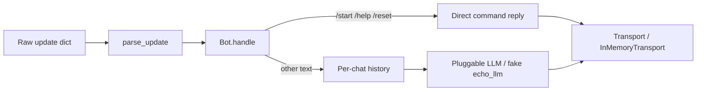

<p align="center">
  
</p>

<h1 align="center">Telegram AI Bot</h1>

<p align="center">
  <strong>A Telegram AI bot that routes updates to a pluggable LLM — with built-in commands and a fake transport — in Python.</strong><br>
  Parse an update, handle <code>/start</code> and <code>/help</code> directly, answer everything else with any <code>(prompt) -&gt; reply</code> model. Runs fully offline.
</p>

<p align="center">
  <em>Built and maintained by <a href="https://viprasol.com">Viprasol Tech</a> — Fintech Experts. Full-Stack Builders.</em>
</p>

<p align="center">
  <a href="https://github.com/Viprasol-Tech/telegram-ai-bot/actions/workflows/ci.yml"></a>
  <a href="LICENSE"></a>
  
  <a href="https://t.me/viprasol_help"></a>
  <a href="https://github.com/Viprasol-Tech/telegram-ai-bot/stargazers"></a>
</p>

---

> ## Offline & pluggable by design
> The LLM is a plain `Callable[[str], str]` and the outbound channel is a small `Transport` protocol. A deterministic **fake LLM** and an **`InMemoryTransport`** ship in the box, so the demo and the entire test-suite run with **no API token, no network, and no `python-telegram-bot` dependency**. Swap in a real model and a real Telegram client whenever you're ready.

---

## Features

- **Real update parsing** — turn a raw Telegram update dict into a typed `Update(chat_id, text, command, args)`, stripping `@botname` and lower-casing commands.
- **Command vs. LLM routing** — `/start`, `/help`, and `/reset` are handled directly; any other text is answered by the pluggable model.
- **Per-chat history** — a bounded, isolated conversation history per `chat_id` is fed to the LLM as context.
- **Pluggable LLM** — pass any `(prompt) -> reply` callable; the bundled `echo_llm` keeps things deterministic and offline.
- **Pluggable transport** — `Transport` protocol + `InMemoryTransport` that records every reply for tests and demos.
- **CLI** — `telegram-ai-bot demo` feeds a scripted multi-chat conversation and prints every reply offline.
- **Modern tooling** — ruff, mypy (strict), pytest, GitHub Actions CI.

## Quickstart

```bash
git clone https://github.com/Viprasol-Tech/telegram-ai-bot.git
cd telegram-ai-bot
python -m pip install -e ".[dev]"

# Feed scripted updates to the offline bot and print replies:
telegram-ai-bot demo
telegram-ai-bot version
```

## Use it in code

```python
from telegram_ai_bot.bot import Bot
from telegram_ai_bot.transport import InMemoryTransport


def my_llm(prompt: str) -> str:  # plug in any (prompt) -> reply model
    return f"echo: {prompt.splitlines()[-1]}"


bot = Bot(transport=InMemoryTransport(), llm=my_llm)

bot.handle_raw({"message": {"chat": {"id": 1}, "text": "/start"}})  # direct reply
sent = bot.handle_raw({"message": {"chat": {"id": 1}, "text": "hi"}})  # routed to my_llm
print(sent.text)  # -> "echo: hi"
print(bot.history(1))  # -> ["hi"]
```

## Architecture



## Roadmap

- [x] Update parsing, command/LLM routing, per-chat history
- [x] Pluggable LLM + fake; `Transport` protocol + `InMemoryTransport`
- [ ] Real Telegram long-polling / webhook transport adapter
- [ ] Real LLM adapters behind the same callable
- [ ] Rate limiting and inline keyboards

## Contributing

PRs welcome — see [CONTRIBUTING.md](CONTRIBUTING.md) and our [Code of Conduct](CODE_OF_CONDUCT.md).

## 📬 Contact — Viprasol Tech Private Limited

- 🌐 Website: [viprasol.com](https://viprasol.com)
- ✉️ Email: [support@viprasol.com](mailto:support@viprasol.com)
- 💬 Telegram: [t.me/viprasol_help](https://t.me/viprasol_help) · 📱 WhatsApp: +91 96336 52112
- 🐙 GitHub: [@Viprasol-Tech](https://github.com/Viprasol-Tech) · 💼 [LinkedIn](https://www.linkedin.com/in/viprasol/) · 𝕏 [@viprasol](https://twitter.com/viprasol)

> *Viprasol Tech — fintech software, algorithmic trading systems, MT4/MT5 bots, AI voice agents, and B2B SaaS. Need a custom build? [Get in touch](mailto:support@viprasol.com).*

## License

[MIT](LICENSE) (c) 2025 Viprasol Tech Private Limited
